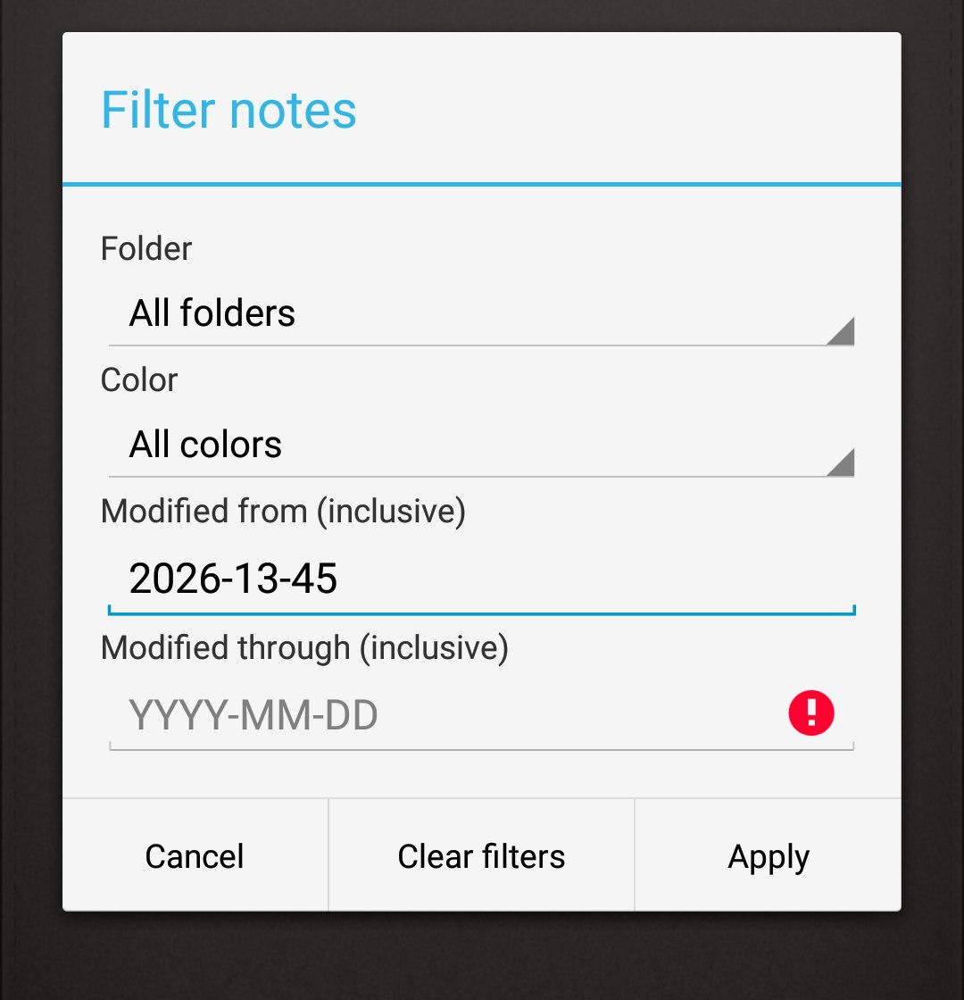
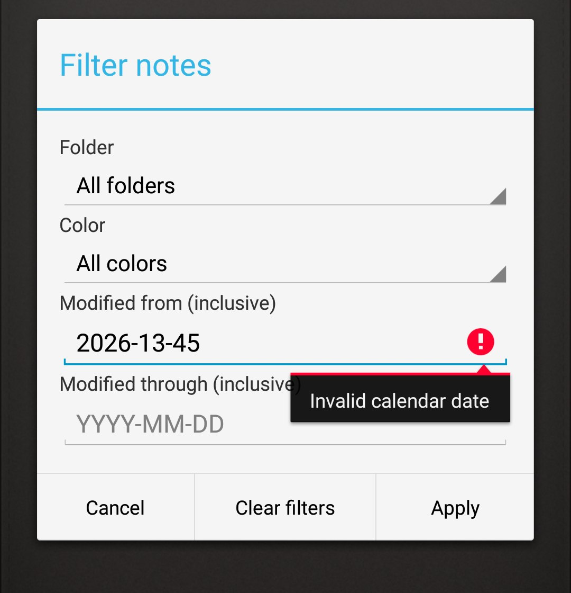
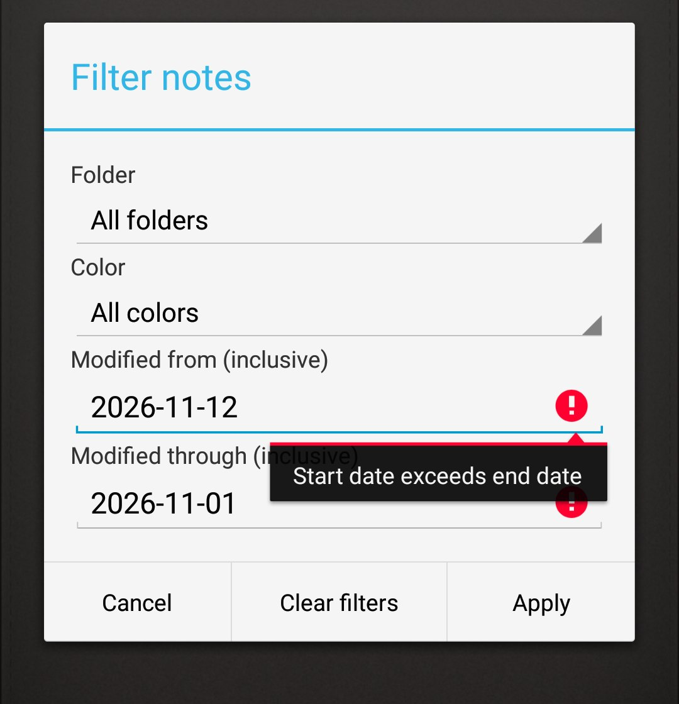

# 原版编译运行摘要（毕子健）

- 实际日期：2026-11-12
- 承担任务：独立环境搭建、未维护基线编译运行、个人运行记录整理、维护版复核与缺陷修复
- 运行对象：未维护基线 `1fa9ebb71d798c730e5ca7e6ae437dac9de39d89`（对应用户记录与截图）
- 复核对象：维护版 `main`（复核时代码 `db4134e`）

## 1. 本机环境

| 项 | 实际值 |
| --- | --- |
| 操作系统 | Windows 10.0.26200 |
| JDK | Microsoft OpenJDK 17.0.21.0.2 LTS |
| Android SDK | Platform 34、Build Tools 34.0.0、Platform Tools |
| Gradle | 8.7（仓库 Wrapper）；Android Gradle Plugin 8.4.0 |
| 模拟器 | Android 9 / API 28 / x86_64（`system-images;android-28;google_apis;x86_64`，pixel_2），WHPX 硬件加速 |
| 设备号 | emulator-5554 |

SDK 通过 `ANDROID_HOME` 定位，未提交 `local.properties`。

## 2. 获取代码与创建基线目录

```powershell
git clone https://github.com/xiaojian-fei/micode-notes-course.git
cd micode-notes-course
git worktree add --detach ../micode-notes-baseline 1fa9ebb
```

基线目录只保留历史基线源码；构建时借用维护工程的 Gradle Wrapper，不把维护版业务代码混入基线。

## 3. 构建

```powershell
& ..\micode-notes-course\gradlew.bat -p . --console=plain assembleDebug
```

结果：

```text
BUILD SUCCESSFUL in 35s
29 actionable tasks: 29 executed
```

产物：`build\outputs\apk\debug\MiCodeNotes-debug.apk`（1,050,899 字节）。
首次构建的依赖下载由本机网络完成，构建过程中未出现编译错误。

## 4. 安装与运行

```powershell
adb -s emulator-5554 install -r build\outputs\apk\debug\MiCodeNotes-debug.apk
adb -s emulator-5554 shell am start -n net.micode.notes/.ui.NotesListActivity
```

- 安装返回 `Success`。
- 启动后显示原版便签列表，底部为“＋ Add note”。
- 新建便签输入测试文本，按两次返回（第一次收起键盘、第二次保存）回到列表，列表中正常出现该便签。
- 重新打开确认内容保留；修改后再次保存，重新打开确认修改生效。
- 数据库核对：`PRAGMA user_version = 4`，`data` 表对应记录内容为修改后的文本，说明写入真实落库。

## 5. 运行中遇到的两个环境问题

两项均属设备环境问题，未改动源码，处理方式见本组另一分支的
`docs/环境修复与复现说明.md` 与 `scripts/fix-emulator-env.ps1`。

1. **新建便签无法保存**：设备上残留维护版（数据库 version 5）数据，基线 `DB_VERSION = 4`，`adb install -r` 保留旧库导致
   `SQLiteException: Can't downgrade database from version 5 to 4`，写入全部失败。
   处理：`adb shell pm clear net.micode.notes` 后基线重建 version 4 数据库，保存恢复正常。
2. **无法输入中文**：镜像默认输入法为英文 Gboard。API 28 `google_apis` 镜像自带谷歌拼音但未启用，
   处理：`ime enable` / `ime set com.google.android.inputmethod.pinyin/.PinyinIME`。

## 6. 维护版复核

在自己电脑上按 README 编译并安装维护版，复核范围与结果如下。

构建与安装：

```text
BUILD SUCCESSFUL in 1m 8s（assembleDebug，29 tasks）
安装 Success；启动后数据库 PRAGMA user_version = 5，note 表含 pinned 列（无损升级）
```

手工复核：

| 功能 | 操作 | 实际结果 |
| --- | --- | --- |
| F3 内容统计 | 编辑页 Ctrl+M → Content statistics | 显示 `Characters (Unicode code points): 19`、`Logical lines: 1`，与测试文本长度一致 |
| F1 置顶 | 编辑页 Ctrl+M → Pin note → 返回列表 | 列表首位显示 `↑ PIN · <标题>`，排序正确 |
| F2 组合筛选 | 首页 Ctrl+M → Filter notes | 对话框含文件夹、颜色、起止日期；非法日期被拦截且不崩溃 |
| B1 字面搜索 | 首页 Ctrl+M → Search | 输入正则特殊字符 `[` 不崩溃；`alpha` 正常命中 |

仪器测试（README 说明的 5 个类，不依赖私有旧库副本）：

```text
adb shell am instrument -w -e class net.micode.notes.ContentStatsTests,net.micode.notes.FilterTests,net.micode.notes.FolderNameTests,net.micode.notes.MaintenanceTests,net.micode.notes.SearchQueryTests net.micode.notes.test/android.test.InstrumentationTestRunner

OK (10 tests)
```

## 7. 本次开发实现：修复筛选对话框错误提示字段

复核中发现一处界面缺陷，已在本分支提交修复。

### 复现步骤

1. 首页按 Ctrl＋M → `Filter notes`。
2. 在 `Modified from (inclusive)` 填入非法日期，例如 `2026-13-45`。
3. `Modified through (inclusive)` 留空，点 `Apply`。

### 修复前现象

红色错误图标与提示出现在 **`Modified through`**（未填写的字段）上，而实际出错的是 `Modified from`，用户会被指向错误的输入框。

### 原因

`NoteFilterDialog` 的正向按钮回调把三处校验（开始日期、结束日期、起止先后关系）合并在同一个 `try` 中，且 `catch` 一律调用：

```java
} catch(IllegalArgumentException ex){ mEnd.setError(ex.getMessage()); }
```

由于 `Modified from` 先被解析，它的错误也被标记到 `mEnd`。

### 修改内容

`src/net/micode/notes/ui/NoteFilterDialog.java`：

1. 点击 `Apply` 时先清除两个字段上一次的错误状态。
2. 开始日期、结束日期分别解析，异常落到各自字段，并 `requestFocus()`。
3. 起止先后关系冲突时，两个字段同时标记（两者都参与该冲突）。
4. 校验全部通过后才构造 `NoteFilter` 并回调，行为与筛选结果不变。

### 修复后验证

| 场景 | 实际结果 |
| --- | --- |
| `Modified from` 填 `2026-13-45`，through 留空 → Apply | 错误图标与 `Invalid calendar date` 显示在 **`Modified from`** |
| from 填 `2026-11-12`、through 填 `2026-11-01` → Apply | 两个字段同时标记，提示 `Start date exceeds end date` |
| 合法日期 → Apply | 对话框关闭，列表按条件筛选，与修复前一致 |
| 回归 | `assembleDebug` 构建成功；5 个测试类 **OK (10 tests)** 全部通过 |

### 截图证据

三张截图均为本机模拟器（API 28 / x86_64）实际运行画面，裁切掉与问题无关的区域后提交。

| 图 | 操作 | 观察点 |
| --- | --- | --- |
|  | `Modified from` 填 `2026-13-45`，through 留空，点 Apply | 红色错误图标落在**未填写的 `Modified through`** 上，实际出错的 `Modified from` 无标记 |
|  | 同上 | 错误图标与 `Invalid calendar date` 正确显示在 **`Modified from`** |
|  | from `2026-11-12`、through `2026-11-01`，点 Apply | 两个字段**同时**标记，提示 `Start date exceeds end date` |

## 8. 已验证与未验证

已验证：

- 未维护基线的独立编译、安装、启动，以及新建/保存/重开/修改后重开的完整流程。
- 基线数据库版本与记录内容落地情况。
- 维护版编译、安装、数据库 4→5 升级、F1/F2/F3/B1 手工复核、10 个仪器测试。
- 本次修复的正向与反向场景，以及修复后的回归测试。

未验证：

- `MigrationTests`：需要真实版本 4 数据库副本（`/sdcard/Download/course-migration-v4.db`），本次未执行。
- 提醒（Remind me）的实际到期弹窗与声音：未做长时间等待验证。
- 颜色/字号、文件夹移动、同步等既有功能未逐一回归。

## 9. 证据位置

已提交到仓库的证据：

- `docs/team/screenshots/filter-error-before-wrong-field.jpg`：修复前错误提示标错字段
- `docs/team/screenshots/filter-error-after-from-field.jpg`：修复后提示落在开始日期
- `docs/team/screenshots/filter-error-after-range-both.jpg`：修复后区间倒置时双字段标记

按小组要求私下交接、未提交到公开仓库的材料：

- 基线的构建日志、安装日志、四张运行截图（构建成功、原版首页、编辑内容、修改后重新打开）及设备信息，
  随个人记录包一并交接。
- 维护版复核过程的其余截图保留在本地记录中，如有需要可另行提供。